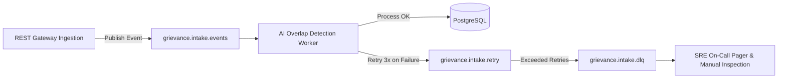

# AICTE Sanyojika - Asynchronous Messaging & DLQ Topology

**Specification Code:** AICTE-MSG-DLQ-2026-V1  
**Broker Target:** Apache Kafka / RabbitMQ Streams  
**SLA Guarantee:** At-Least-Once Delivery with Idempotent Deduplication

---

## 1. Message Broker Architecture

---

## 2. Exponential Backoff & Dead-Letter Queue (DLQ)
- **Retry Attempts:** 3 iterations
- **Backoff Formula:** $T_{retry} = T_{base} 	imes 2^{attempt} + 	ext{jitter}$ (where $T_{base} = 5	ext{s}$)
- **DLQ Retention:** 14 days in durable storage for manual replay
- **Monitoring Trigger:** Alert triggered if DLQ message count exceeds 5 in a rolling 1-hour window
