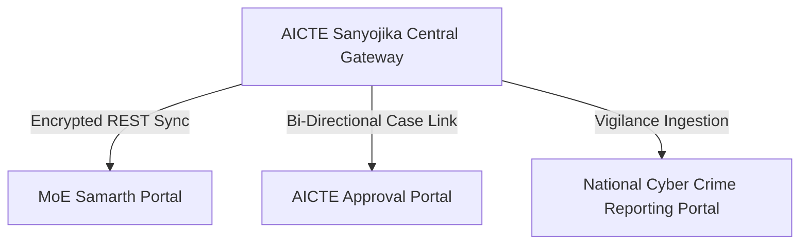

# AICTE Sanyojika - National Portal Integration & Federation Manual

**Target Ecosystem:** MoE Samarth eGov, AICTE Central Approval Portal, National Cyber Crime Reporting Portal (NCRP)  
**Standard:** Open Data API Specification / REST JSON over TLS 1.3

---

## 1. Federation Topology

---

## 2. Synchronized Data Entities
- **AICTE Permanent ID (PID) Master Catalog:** Real-time sync of approved branches and intake caps.
- **Regulatory Action Flags:** Instant push of show-cause notices and zero-intake directives.
- **Inter-Agency Vigilance Feed:** Push notifications for cases involving fraud, extortion, or degree falsification.
